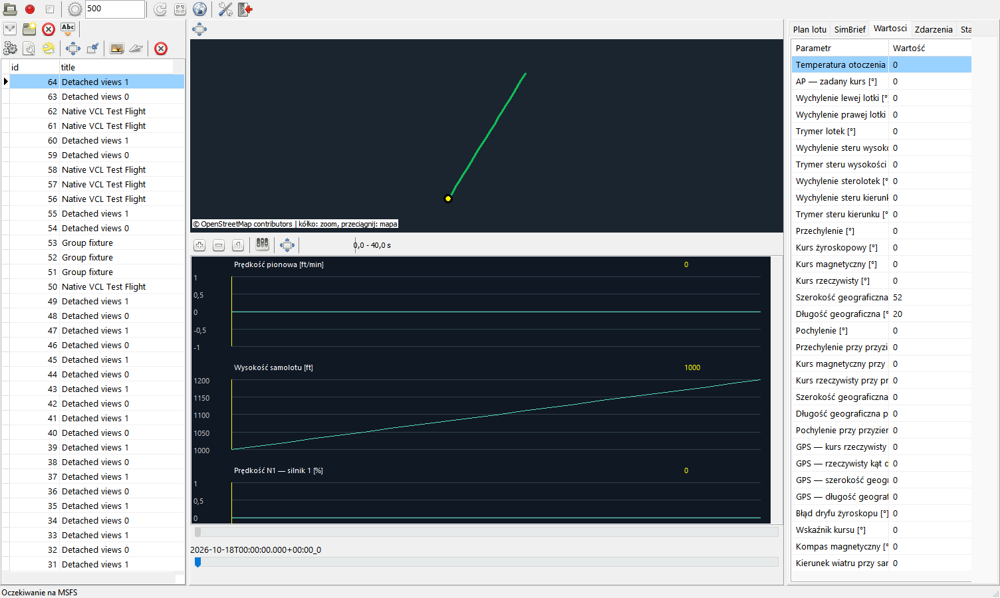
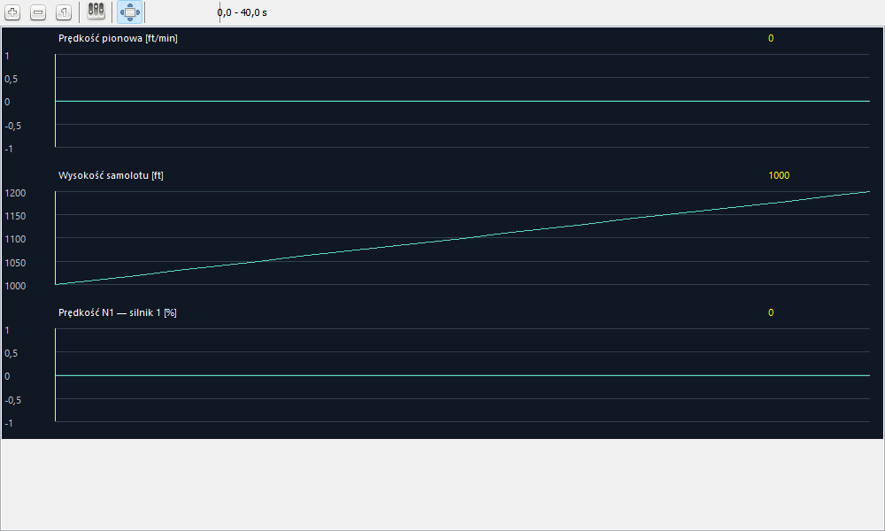
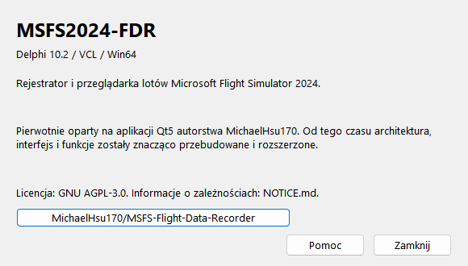

# MSFS2024-FDR — Delphi 10.2 VCL Win64

[Traducciones de la interfaz](Translation.es.md)

[Polski](README.md) | [English](README.en.md) | [Deutsch](README.de.md) | [Español](README.es.md)

Grabador y visor nativo para Microsoft Flight Simulator 2024. El proyecto, actualmente privado, comenzó a partir de MSFS-Flight-Data-Recorder (Qt). Desde entonces se rediseñaron grabación, arquitectura, base de datos, interfaz, integraciones y análisis. Se conserva atribución en NOTICE y AGPL-3.0 en LICENSE. No utiliza Qt.

## Interfaz y vistas independientes

Se conserva el nuevo diseño de frmMain. `aMapWindow` y `aGraphWindow` abren mapa/gráficos en ventanas redimensionables independientes. Todo el contenido de MapPanel y GraphPanel está en fraMapU/fraGraphU. Cambian de padre las mismas instancias, sin duplicar vuelos. La vista separada desaparece de la ventana principal. Cerrar la ventana o repetir la acción la devuelve. Pueden separarse ambas simultáneamente. Selección de vuelo, línea temporal, cursor, intervalo y acciones siguen conectados. Cerrar la principal también cierra correctamente las ventanas auxiliares.

Configurar gráficos permite buscar sin perder marcas, elegir más de ocho parámetros, ordenar u ocultar. frmChartsConfigure tiene ImageList/ActionList propios para subir/bajar/ocultar/aceptar/cancelar. Solo Aceptar aplica la copia; Cancelar conserva la selección. Se mantienen preferencias de parámetros temporalmente ausentes en otro avión.

Arrastrar desplaza el tiempo; Mayús+arrastrar amplía selección; Ctrl+rueda hace zoom; doble clic muestra todo. Rueda y zoom funcionan separados. Línea temporal, cursor, marcador del mapa e inspector de solo lectura están sincronizados. Doble clic abre una grabación. Los splitters redimensionan paneles; Ajustes restaura valores predeterminados. La altura del mapa acoplado se conserva al separarlo.

El mapa admite arrastrar/rueda, teselas OSM opcionales con atribución/caché, rutas, contactos, PNG y KML convirtiendo altitud ft→m. La vista de todas las rutas colorea grupos. Se pueden crear, asignar, renombrar o eliminar grupos sin borrar vuelos. Las consultas grandes de vuelos/bases siguen ejecutándose en el hilo UI y pueden bloquearlo temporalmente.

## Ejecución e idioma

Ejecute `bin/MSFS2024-FDR.exe` con SimConnect.dll Win64, sqlite3.dll, WebView2Loader.dll y MSFS2024-FDR.i18n al lado. WebView2 Runtime renderiza Markdown; mapa/gráficos son VCL/GDI. [Dependencias](runtime/README.es.md).

El idioma predeterminado es polaco. Herramientas → Idioma o Ajustes → General ofrece PL/EN/DE/ES. settings.ini guarda pl-PL/en-US/de-DE/es-ES; códigos desconocidos vuelven al polaco. El [catálogo externo](translations/README.es.md) se copia al compilar. FMC/METAR/OFP brutos, datos e identificadores técnicos no se traducen. Consultas e informes de IA permanecen expresamente en polaco. Ajustes tiene General, Análisis y Proveedores IA con páginas Codex/Gemini/Ollama. bin/settings.example.ini es una plantilla, no configuración privada para Git.

## Grabación y base de datos

Grabación automática desde vuelo cargado y primera telemetría válida, incluso con motores apagados, hasta fin/menú/cambio de avión/desconexión. La pausa no termina el vuelo ni añade muestras; Detener manual desactiva automatismo. Intervalo en ms, predeterminado 500; 250 es objetivo, no frecuencia garantizada.

Un worker posee grabación, lectores auxiliares y conexión FireDAC propia. Los comandos UI se encolan y el estado es una copia. SQLite usa WAL y conexiones de lectura/escritura separadas. Cambiar/cerrar espera al worker. No borre WAL/SHM activos ni copie únicamente una DB abierta. La telemetría principal guarda snapshots completos; SDK opcionales usan base y cambios, omitiendo pantallas/mensajes FSHud idénticos.

Se vacía la cola de recepción antes de trabajo costoso, conservando última muestra y transiciones suelo/aire. Surface 255 no detiene grabación en vuelo. Los errores auxiliares se aíslan; errores principales de definición/petición son fatales y quedan registrados. Flow es opcional; FlightLoaded y sondeo de diez segundos ofrecen alternativa. Falta una prueba real completa de fin de vuelo para esta alternativa.

El catálogo SimConnect contiene 709 definiciones: 110 números, 70 flags empaquetados, 32 valores por motor hasta 16 motores y metadatos/tiempos. Observa 84 eventos de cabina sin enviar comandos. Las bases Qt existentes siguen siendo legibles; se añaden columnas ausentes. La reparación transaccional conserva motores/bits/arrays; la corrección horaria se versiona una vez. Antes se crea copia coherente .before-native-<GUID>.db mediante API SQLite. No use dos grabadores sobre la misma DB. msfs_fdr_debug.log/.old registra FATAL/WARNING/INFO/TRACE/PROFILE.

## Aviones y fuentes auxiliares

Detección por título; SDK verificado tiene prioridad y el resto permanece SimConnect. Ausencia/caducidad es null. Una L-var cero puede ser inexistente; se conserva procedencia/validez.

| Fuente | Datos |
|---|---|
| iFly 737 MAX | SDK oficial 1.5, memoria compartida, 2411 campos, indicadores numéricos ensamblados y FMC/texto/estilos/luces separados |
| [Fenix](support/fenix/README.es.md) | 1203 L-vars mediante SimConnect de lectura propio |
| [FBW A32NX](support/fbw/README.es.md) | 223 L-vars con comprobación de disponibilidad |
| [PMDG NG3](support/pmdg/README.es.md) | Client Data SDK oficial y ambos CDU |
| [AIRLINER](support/airliner/README.es.md) | 31 L-vars comunes de instrumentos |
| [GSX](support/gsx/README.es.md) | 16 L-vars de servicios/contadores |
| [FSHud](support/fshud/README.es.md) | Protocolo local filtrado, localhost:19786 |

El [historial FMC](support/fmc/README.es.md) guarda texto bruto y referencias conservadoras con tiempos. TAKEOFF REF lee V1/VR/V2 seleccionados y no QRH; APPROACH REF usa FLAP/SPD, no una fila VREF arbitraria. PERF INIT/N1 LIMIT añade pesos, combustible, CI, altitudes, CG, trim, temperaturas asumida/OAT, N1, ACT/SEL, derate y bump. iFly/PMDG comparten provisionalmente parser Boeing, pendiente comparación PMDG real. Fenix/FBW requieren [FlightPadFMC](support/flightpad/README.es.md) actualizado y conectado; INIT/PERF aporta VAPP/VLS, FLEX, THS y más. VLS no es VREF. Páginas ocultas son últimas observaciones, no lectura continua de memoria.

## Análisis, meteorología y planificación

Información del vuelo muestra identificadores, aeropuertos/pistas, tiempos/duración, recuentos, METAR de eventos, evidencias SimBrief y últimas referencias FMC anteriores a cada contacto. Despegue y aterrizaje tienen títulos de informe distintos. Codex CLI requiere codex login y codex.exe nativo; Gemini necesita clave API. [Ollama](support/ollama/README.es.md) obtiene modelos con GET /api/tags y analiza con POST /api/chat, sin instalar modelos. Análisis en segundo plano, Markdown guardado en DB y mostrado por WebView2. Mayús+clic regenera en lugar de abrir el informe almacenado.

Intervalos separados: despegue 60 s antes/30 después, aterrizaje 180/30, configurables. Contexto con tres decimales como máximo y deltas con banda ±0,0015 frente al último estado emitido; los datos brutos no cambian. Detentes breves de flaps pueden proceder de ejes analógicos. Se añaden AP/AT, cada pata de tren, meteorología, motores y referencias disponibles. Una velocidad A/T estable en final solo puede usarse como referencia alternativa explícita si falta VREF.

Temperatura/presión son locales junto al avión, no METAR/QNH del aeropuerto. Despegue usa última muestra en tierra hasta separarse y aterrizaje primera muestra en tierra desde la toma, buscando todo el vuelo. Ausencia queda explícita; METAR de la hora del evento es otra observación. Asociación de pista usa facilities, umbrales desplazados, geometría métrica y rumbo verdadero. No reconocido queda vacío; el punto de despegue no demuestra inicio exacto de rotación. Aeropuertos complejos y viento cruzado requieren pruebas reales adicionales.

El plan EFB se lee con GET_EFB_ROUTE y puente Community localhost:19787/efb-route; PLN es importación alternativa. Rutas iguales se deduplican y cambios se conservan por vuelo; no se inventan coordenadas de procedimientos. Configure usuario/Pilot ID SimBrief. Descargar y asignar son pasos distintos: aeropuertos/ruta e identificadores disponibles deben coincidir. Planes antiguos se permiten opcionalmente con evidencias y aviso de reutilización. No se presupone que el plan actual de la cuenta sea una ruta de pruebas. Respuesta bruta/OFP quedan en el vuelo.

SimBrief muestra grupos VCL plegables de vuelo, resumen, carga, ruta, comentarios, ATC, OFP LIDO, pista, mapas y aeropuertos/alternativos. El mismo frame abre en ventana redimensionable. El texto multilínea crece y toda la vista desplaza con rueda. Se omiten prefijos de rutas API y Flight-plan-downloads. OFP permanece en idioma original.

## Compilación y pruebas

Delphi 10.2, `src/MSFS2024-FDR.dproj`, Win64 o build.ps1. i18n se busca en ../i18n/Packages o vendor/i18n/Packages; -I18nRoot/I18nRoot permite otra ruta. WebView4Delphi desde vendor/proyecto vecino. No se distribuyen binarios SDK propietarios.

```powershell
python tools/check_translations.py
python tools/check_project.py
python tools/check_documentation.py
powershell -ExecutionPolicy Bypass -File test.ps1
python tools/check_dependencies.py
python tools/package.py
```

Unidades NameU.pas; formularios frmNameU.pas/.dfm, frames fraMapU/fraGraphU. src se organiza por función y todas las unidades figuran explícitamente en DPR/DPROJ. DCU/OBJ/HPP/DCP/BPL van a .build/<Platform>/<Config>, con pruebas separadas. Iconos embebidos en DFM, también en el diálogo independiente de gráficos. [Cobertura y límites](Testy.es.md): pruebas sintéticas no validan valores reales ni calidad de IA. README/Testy están en polaco sin sufijo y .en/.de/.es.md.

## Grupos de grabaciones

La lista de grupos filtra las grabaciones. La entrada vacía muestra todas, incluidas las que no tienen grupo. La actualización conserva el filtro. La asignación abre un diálogo con el grupo actual; Aceptar guarda y Cancelar conserva la asignación. «Sin grupo» elimina la asignación.

[MichaelHsu170/MSFS-Flight-Data-Recorder](https://github.com/MichaelHsu170/MSFS-Flight-Data-Recorder) — AGPL-3.0.

## Toolbar frames — 2026-10-18

Las acciones e ImageLists de las barras pertenecen ahora a fraMap/fraGraph y se guardan en sus DFM. El menú principal utiliza las mismas acciones; main conserva referencias y el cambio de ventanas. El frame de gráficos controla el zoom. En ventanas separadas, btnGraphWindow y btnMapWindow devuelven el mismo frame a frmMain. Los índices de iconos siguen siendo compatibles con el menú principal. También se corrigieron propiedades DFM de TFrame y entradas uses inválidas de la configuración de gráficos.

## Capturas de pantalla

Las capturas muestran la aplicación real con datos de prueba sintéticos, no un vuelo real grabado.







## Ayuda CHM y F1

F1 o Ayuda → Contenido de ayuda abre el tema de la vista activa. Incluye introducción, mapa, gráficos, análisis, configuración e información del programa. PL/EN/DE/ES siguen el idioma de la interfaz.

Compilar: `python tools/build_help.py --require-chm`. Requiere HTML Help Workshop; HHC_EXE permite indicar otra ruta de hhc.exe. build.ps1 también compila la ayuda. Sin compilador hay HTML local; F1 utiliza HTML si falta CHM. Salida: bin/help. Distribuye el directorio help completo junto al EXE.

Reconstruir iconos pequeños: `powershell -ExecutionPolicy Bypass -File tools/rebuild_toolbar_images.ps1 -List small`.

## Nombres de parámetros legibles

Gráficos, listas de selección/orden e inspector muestran descripciones con unidades, como `Altitud del avión [ft]` y `Velocidad N1 — motor 2 [%]`. Siguen el idioma de la interfaz. La búsqueda acepta nombres e identificadores originales y las ayudas muestran ambos.

La base, el modelo y la configuración conservan los identificadores originales. Hay descripciones completas de 212 parámetros estándar y de AIRLINER, GSX y FSHud. Los demás nombres SDK/LVAR se separan en palabras legibles, conservando proveedor, abreviaturas e índices. No se inventan unidades de campos desconocidos. Los valores de 0–1 no se etiquetan como porcentajes sin convertirlos.


### Unidades de visualización

En Configuración → Unidades elige la unidad de destino por cada unidad original, p. ej. ft → m, lb → kg, US gal → l. Mantener la misma unidad desactiva la conversión. Se actualizan los gráficos (curvas, escalas y cursor) y el inspector, incluso en ventanas separadas. La base de datos y los datos de análisis conservan sus unidades originales. No se adivinan unidades desconocidas del SDK.


### Arrastrar gráficos

En Configurar gráficos, arrastra un parámetro de izquierda a derecha para insertarlo en la posición elegida. Arrastrarlo de derecha a izquierda oculta el gráfico. Mantén Ctrl al arrastrar dentro de la lista derecha para cambiar el orden. Una línea marca la inserción y ambas listas desplazan su contenido cerca de los bordes. Las casillas y botones siguen funcionando. Aceptar aplica la copia de trabajo; Cancelar conserva la selección anterior.


### Idioma de Windows, nueve idiomas y VersionInfo

La opción inicial es auto. Se detecta el idioma de interfaz de Windows sin alterar los formatos numéricos/de fecha. Las variantes regionales se asignan a PL/EN/DE/ES/FR/RU/TR/IT/PT; los idiomas no admitidos usan inglés. Auto se conserva al reiniciar y las elecciones explícitas existentes se respetan. Menú y ajustes incluyen diez opciones. Se traducen las nuevas etiquetas GUI. La ayuda sigue en cuatro idiomas, con inglés para los nuevos. Los textos nuevos son una primera traducción local Qwen3 con correcciones terminológicas, sin revisión nativa. VersionU lee VersionInfo fijo/textual y tablas de idiomas; Acerca de muestra versión real, ProductName y copyright. Build común: 2 (0.1.0.2); se conservan los demás números y datos del autor. bump_build.py incrementa solo Build por cambio lógico; check_version.py valida la herencia. La compilación CLI usa MSBuild para generar los recursos de versión.


Ampliación: la interfaz admite 25 configuraciones regionales. Nuevas: en-GB, fr-CA, pt-BR, de-AT, de-CH, be-BY, el-GR, uk-UA, hr-HR, cs-CZ, da-DK, nl-NL, fi-FI, nb-NO, sk-SK y sv-SE. Las variantes regionales se guardan por separado. be significa bielorruso; no/nb/nn usan la traducción noruega Bokmål disponible, sin una versión Nynorsk independiente. El alemán suizo usa ss en lugar de ß. La detección automática sigue el idioma de Windows sin cambiar formatos numéricos. La ayuda sigue en PL/EN/DE/ES, con idioma base o inglés como alternativa. Las traducciones nuevas son una primera versión con correcciones terminológicas y validación estructural, sin revisión por hablantes nativos. Build: 0.1.0.3; los demás datos de versión y autor no cambian.


La interfaz contiene 32 configuraciones regionales ordenadas por código. Nuevas: ar-SA, he-IL, hi-IN, id-ID, ja-JP, vi-VN y zh-CN. ar/he seleccionan sus variantes; los alias antiguos iw/in corresponden a he/id. Árabe y hebreo usan RTL; gráficos, mapas y texto original FMC/METAR/OFP mantienen LTR. Las fuentes Noto de assets/fonts se copian a bin/fonts y a los archivos, con licencias OFL y sumas de procedencia; se cargan de forma privada sin instalación en Windows. La ayuda y documentación mantienen cuatro idiomas. Avisos sobre traducciones: Translation.es.md. Build 0.1.0.4.


StackTrace captura pilas de llamadas de excepciones. Conserve MSFS2024-FDR.pdb junto al EXE exacto para el que se generó; el archivo está incluido en el paquete. Al informar de un problema indique la versión y el fragmento pertinente de msfs_fdr_debug.log. Compilar requiere map2pdb.exe en PATH; el MAP detallado se convierte después de la compilación.
